<p align="center">
  
</p>

<p align="center">
  
</p>

---

### `$ uname -a`

<p align="center">
  
  
  
  
</p>

### `$ ls ~/toolchain`

<p align="center">
  
  
  
  
  
  
  
</p>

<!--
### `$ ls ~/projects --featured`

| repo | lang | what it does |
|------|------|--------------|
| [repo-name](https://github.com/ha-ja/repo-name) | Kotlin | short description |
-->

---

<details>
<summary>📂 <code>~/</code> <i>(click to look around)</i></summary>
<blockquote>

<details>
<summary>📄 <code>.bashrc</code></summary>

```bash
PS1='\u@\h:\w\$ '
alias ll='ls -lah'
alias ..='cd ..'
```

</details>

<details>
<summary>📁 <code>.config/</code></summary>
<blockquote>

<details>
<summary>📄 <code>motd</code></summary>

```text
welcome. nothing to see here... or is there?
```

</details>

<details>
<summary>📁 <code>.cache/</code></summary>
<blockquote>

<details>
<summary>📁 <code>thumbnails/</code></summary>

```console
$ ls -a
.  ..
```

</details>

<details>
<summary>📁 <code>.deeper/</code></summary>
<blockquote>

<details>
<summary>🔑 <code>.secret</code></summary>

```text
 _                 _
| |__   __ _      (_) __ _
| '_ \ / _` |_____| |/ _` |
| | | | (_| |_____| | (_| |
|_| |_|\__,_|    _/ |\__,_|
                |__/

you made it all the way down.
```

</details>

</blockquote>
</details>

</blockquote>
</details>

</blockquote>
</details>

<details>
<summary>📁 <code>projects/</code></summary>

```console
$ ls -a
.  ..  work-in-progress
```

</details>

</blockquote>
</details>

<p align="center"><code>exit 0</code></p>
